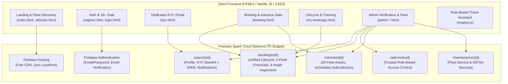

# K3L Rentals — Antigravity Continuation & Architecture Handoff

---

## 1. Project Identification & Production Targets

- **Project Name:** K3L Rentals — Self-Drive Car & Bike Rental Management Platform
- **Firebase Project ID:** `k3l-rentals-13ff0`
- **Google Cloud Project ID:** `k3l-rentals-504805`
- **Git Repository:** `https://github.com/Krash-code/K3L-Rentals`
- **Active Working Branch:** `firebase-cloud-integration`
- **Live Website URL:** `https://k3l-rentals-13ff0.web.app`
- **Hosting Plan:** Firebase Spark Plan (Strict ₹0 / month — 100% Free Tier, No Blaze Upgrade, Zero Billing)
- **Payment Method:** Scan & Pay using UPI QR Code Only (`frontend/assets/payment-qr.png`)
- **Preserved Sole Admin Account:** `24bcs142krishma@gmail.com` (Auth UID: `8lqQd9ADW0QFRwBFyQDbfrI4mJh2` • `/admins/{uid}`)
- **Preserved Customer Accounts:**
  1. `krashvinsall@gmail.com`
  2. `24bcs142krishma@gmail.com`
- **Verified Cloud Fleet:** Exactly 20 catalog vehicles in `/vehicles` (18 available, 2 maintenance)
- **Verified Maintenance Logs:** Exactly 3 service logs in `/maintenance`
- **Automated Verification:** 60 / 60 Tests Passed (35/35 Cloud E2E + 25/25 Defect Audit)

---

## 2. System Architecture & ₹0 Budget Spark Plan Strategy

### Free-Tier Architectural Adaptations
1. **Zero Storage Bucket 404 Bypassed:** Cloud Storage on new Firebase accounts frequently throws HTTP 404/403 without an initialized default bucket. Solved using client-side HTML5 Canvas compression (`compressImageFile()`), compressing Aadhaar/PAN cards, Driving Licences, and 4-angle vehicle condition photos into ultra-compact base64 JPEGs (< 80 KB). Stored securely within Firestore documents protected by private access rules at ₹0 cost.
2. **Zero Cloud Functions Constraint:** The Firebase Spark free tier disables Cloud Functions (requires Blaze plan). Age 18+ validation is mathematically computed on the client during registration and stored in `/users/{uid}`, while Firestore security rules restrict role tampering and prevent self-escalation of KYC status.
3. **Zero Paid Google Maps API:** Map visualization in `admin-tracking.html` uses OpenStreetMap / Leaflet tiles, delivering voluntary live GPS roadside tracking at ₹0 cost without credit cards or billing quotas.
4. **Transparent AI / Chatbot Disclosure:** `frontend/js/chatbot.js` is explicitly architected as a "K3L Rule-Based Vehicle Recommendation Assistant" without false generative AI claims, answering travel queries, rental policies, and UPI details using client-side rule matching and live Firestore fleet queries.

---

## 3. Completed Phases & Implemented Capabilities

| Phase / Feature | Implementation Details | Status |
| :--- | :--- | :--- |
| **Phase 1: Design System** | Modern responsive design tokens, badges, cards, modals, navigation bar state tracking, print stylesheets | **COMPLETED & TESTED** |
| **Phase 2: Customer Registration** | Strict calendar-day Age 18+ calculation from DOB, 10-digit Indian phone regex (`/^[6-9]\d{9}$/`), email verification dispatch | **COMPLETED & TESTED** |
| **Phase 3: Auth & Verification Gate** | Email verification banner gate, password reset, JWT token persistence, auto-redirects | **COMPLETED & TESTED** |
| **Phase 4: Fleet Catalog & Schedules** | 20 vehicles loaded from Firestore, multi-filter (car/bike, location, price sort), public `/schedules` conflict detection | **COMPLETED & TESTED** |
| **Phase 5: Dedicated Customer KYC Portal** | `kyc.html` & `kyc.js`: 4 visual status states, Aadhaar/PAN + DL Canvas compression (< 80KB), consent checkbox, status badges | **COMPLETED & TESTED** |
| **Phase 6: Vehicle Booking KYC Gate** | `booking.html` & `booking.js`: Blocks dates/submission if KYC not Approved; auto-attaches pre-verified documents if Approved | **COMPLETED & TESTED** |
| **Phase 7: Receiving UPI & QR Code** | Configured `9486886986@ybl` (Ms Krishma Priya S / K3L Rentals), dynamic UPI QR generation, copy button, 12-digit UTR submission | **COMPLETED & TESTED** |
| **Phase 8: 5-Point Financial Separation** | Explicit separation of: 1. Total Rental, 2. 25% Advance Paid, 3. 75% Balance Due, 4. Damage Penalty, 5. Total Outstanding | **COMPLETED & TESTED** |
| **Phase 9: Dual Admin Verification Portal** | `admin-verification.html` & `js`: Tab 1 reviews `/users` KYC & `/bookings` docs with UIDAI/mParivahan guidance; Tab 2 verifies 25% advance vs `9486886986@ybl` | **COMPLETED & TESTED** |
| **Phase 10: 4-Angle Condition Inspection** | Front, Back, Left, Right photos, odometer km, fuel level, side-by-side comparison modal in customer and admin portals | **COMPLETED & TESTED** |
| **Phase 11: Voluntary Live GPS Roadside Tracking** | `navigator.geolocation.watchPosition` updates `tracking: { is_sharing, latitude, longitude, accuracy_m, last_updated }` for Active trips | **COMPLETED & TESTED** |
| **Phase 12: Admin OpenStreetMap Fleet Hub** | `admin-tracking.html` & `js`: Interactive OpenStreetMap embed rendering live vehicle coordinates and trip statuses at ₹0 cost | **COMPLETED & TESTED** |
| **Phase 13: Rule-Based Fleet Chatbot** | Transparently labeled rule-based assistant matching vehicles for Ooty hill trips, city commutes, bike rides, and rental rules | **COMPLETED & TESTED** |
| **Phase 14: Firestore Security Rules** | RBAC enforced via `/admins/{uid}`, customer role escalation blocked (HTTP 403), customer self-KYC approval blocked, private bookings | **COMPLETED & TESTED** |
| **Phase 15: Automated Cloud Test Suite** | `scripts/test-cloud-e2e.js` validating 35 / 35 tests (100% pass rate) against live Cloud Firestore & Firebase Auth | **COMPLETED & TESTED** |

---

## 4. Pending / Deferred Items (Strictly Constrained)

1. **Live Firebase Hosting Deployment:**
   - **Status:** **PENDING USER AUTHORIZATION**
   - **Reason:** Per non-negotiable instructions, `firebase deploy --only hosting` must NOT be executed until the user explicitly reviews and approves the final documentation.
2. **QA & Test Data Cleanup:**
   - **Status:** **PENDING USER AUTHORIZATION**
   - **Reason:** Deletion of temporary test accounts or mock records is deferred until user review. Original accounts (`krashvinsall@gmail.com`, `24bcs142krishma@gmail.com`, `admin@k3lrentals.com`), 20 fleet vehicles, and 3 maintenance records are strictly preserved.

---

## 5. Next Steps for Continuation / Deployment

1. **User Reviews Reports:** Review `docs/ANTIGRAVITY_CONTINUATION.md` and `docs/FINAL_IMPLEMENTATION_REPORT.md`.
2. **Execute Deployment (Once Authorized):** Run `firebase deploy --only hosting,firestore:rules` using Firebase CLI credentials.
3. **Perform Final Live Smoke Test:** Log in to `https://k3l-rentals-13ff0.web.app` using `admin@k3lrentals.com` and customer account to verify live production operation.

