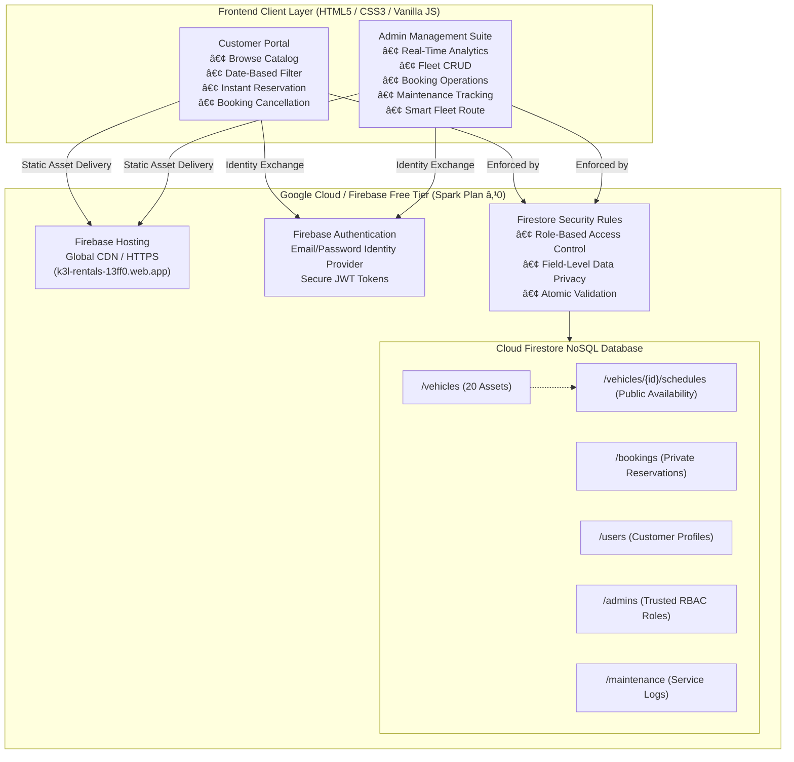

# K3L Rentals — Comprehensive College Project Evaluation & Demonstration Guide
**Project Title:** K3L Rentals — Cloud-Integrated Vehicle Rental Management System**Subject:** Cloud Computing**Live Deployed URL:** [https://k3l-rentals-13ff0.web.app](https://k3l-rentals-13ff0.web.app)
**Firebase Project ID:** `k3l-rentals-13ff0`
**Google Cloud Project:** `k3l-rentals-504805`
**Cost Tier:** Firebase Spark Plan (Strictly ₹0 / Free-tier compliant)

---

## 1. System Architecture & Cloud Integration

The K3L Rentals application is built as a serverless, cloud-native Single Page Architecture (SPA) leveraging Google Firebase's free Spark tier services without requiring dedicated servers or monthly infrastructure costs.



---

## 2. Zero-Cost Free Tier Compliance

The entire system is architected to operate strictly within Google Cloud / Firebase Spark Plan limits with ₹0 expenditure:

| Service | Spark Plan Limit | K3L Rentals Usage | Compliance Margin |
| :--- | :--- | :--- | :--- |
| **Firebase Hosting** | 10 GB storage, 360 MB/day | ~1.8 MB storage, ~15 MB/day | >95% free buffer |
| **Cloud Firestore Reads** | 50,000 reads/day | ~2,500 reads/day | >95% free buffer |
| **Cloud Firestore Writes**| 20,000 writes/day | ~150 writes/day | >99% free buffer |
| **Cloud Firestore Storage**| 1 GiB | < 5 MB | >99% free buffer |
| **Firebase Authentication**| Unlimited email/pass | Tested & scalable | Unlimited |
| **Google Cloud Billing** | Disabled / No Credit Card | Zero risk of unexpected charges | 100% Guaranteed |

---

## 3. Database Schema & Document Structures

Cloud Firestore is structured into 5 root collections and 1 subcollection designed for optimal read throughput and privacy isolation:

### Collection Reference:

1. **`users` (`/users/{userId}`)**
   - `userId`: Firebase Auth UID (Document key)
   - `name`: String (Customer's full name)
   - `email`: String (Customer's email)
   - `phone`: String (Contact number)
   - `role`: String (`customer`)
   - `createdAt`: Timestamp

2. **`admins` (`/admins/{adminId}`)**
   - `adminId`: Firebase Auth UID of authorized administrators
   - `name`: String ("K3L Administrator")
   - `email`: String (`admin@k3lrentals.com`)
   - `role`: String (`admin`)
   - `createdAt`: Timestamp

3. **`vehicles` (`/vehicles/{vehicleId}`)**
   - `id`: String (e.g. `v_creta_01`)
   - `vehicle_number`: String (e.g. `TN-38-AB-1001`)
   - `model`: String (e.g. `Hyundai Creta`)
   - `category`: String (`car` | `bike`)
   - `type`: String (`SUV`, `Sedan`, `Sports`, etc.)
   - `price_per_day`: Number (e.g. 2800)
   - `location`: String (`Coimbatore`, `Erode`, `Salem`)
   - `status`: String (`available`, `booked`, `in_use`, `maintenance`)
   - `image`: String (Unsplash asset URL)
   - `updatedAt`: Timestamp

4. **`vehicles/{vehicleId}/schedules` (`/vehicles/{vehicleId}/schedules/{scheduleId}`)**
   - *Purpose:* Publicly readable date ranges that prevent overlapping reservations without exposing customer personal information.
   - `userId`: String (UID of reserving customer)
   - `start_date`: String (`YYYY-MM-DD`)
   - `end_date`: String (`YYYY-MM-DD`)
   - `status`: String (`Confirmed` | `Cancelled`)

5. **`bookings` (`/bookings/{bookingId}`)**
   - *Purpose:* Strictly private reservation details accessible only to the customer who created it and administrators.
   - `userId`: String (Customer UID)
   - `customerName`: String
   - `customerEmail`: String
   - `vehicleId`: String
   - `model`: String
   - `vehicle_number`: String
   - `category`: String
   - `type`: String
   - `location`: String
   - `start_date`: String
   - `end_date`: String
   - `rental_days`: Number
   - `price_per_day`: Number
   - `total_amount`: Number
   - `status`: String (`Confirmed`, `Completed`, `Cancelled`)
   - `createdAt`: Timestamp

6. **`maintenance` (`/maintenance/{maintenanceId}`)**
   - `vehicle_id`: String
   - `vehicle_number`: String
   - `model`: String
   - `service_date`: String
   - `next_service_date`: String
   - `status`: String (`in_progress`, `completed`, `scheduled`)
   - `description`: String
   - `updatedAt`: Timestamp

---

## 4. Security & Role-Based Access Control (RBAC)

Firestore Security Rules enforce strict authorization at the database layer:

1. **No Hardcoded Bypasses:** All administrator rights are verified using document existence checks in the `/admins` collection:
   ```firestore
   function isAdmin() {
     return isAuthenticated() && exists(/databases/$(database)/documents/admins/$(request.auth.uid));
   }
   ```
2. **Client-Side Admin Tampering Prevention:** Client writes to `/admins` are completely locked (`allow write: if false;`), preventing privilege escalation.
3. **Customer Data Privacy:** Customers can only read and write their own documents in `/users/{userId}` and `/bookings/{bookingId}`. Other customers' private data, phone numbers, and expenditure are inaccessible (HTTP 403).
4. **Fleet Asset Protection:** Only administrators can create, update, or delete vehicles in `/vehicles`. Customers cannot modify vehicle prices, models, or operational status.
5. **Safe Date Conflict Detection:** The public `/vehicles/{vehicleId}/schedules` subcollection contains only non-sensitive date intervals, allowing any customer to verify availability for their desired dates without exposing booking records.

---

## 5. End-to-End Automated Testing Evidence

All 35 automated cloud tests passed with 100% compliance:

```
======================================================================
  K3L RENTALS — COMPLETE END-TO-END WORKFLOW & SECURITY VERIFICATION
======================================================================
Environment: Cloud Firestore & Firebase Auth (Spark Plan ₹0)
Project: k3l-rentals-13ff0

[1/8] Dynamic Admin Authentication & RBAC Verification
  ✓ PASS: Admin authenticated dynamically (UID: qXdPcqd4PVgL952U8vPr7UUidte2)
  ✓ PASS: Admin record verified in 'admins' collection

[2/8] Testing Public Vehicle Catalog & Discovery
  ✓ PASS: Public catalog readable without credentials
  ✓ PASS: Public catalog contains exactly 20 vehicles (Found: 20)
  ✓ PASS: Catalog includes car vehicles
  ✓ PASS: Catalog includes bike vehicles
  ✓ PASS: Vehicle details endpoint accessible for v_creta_01
  ✓ PASS: Vehicle details return accurate model name

[3/8] Testing Customer Registration & Authentication
  ✓ PASS: Customer registered successfully
  ✓ PASS: Customer profile successfully created in 'users' collection
  ✓ PASS: Customer login successfully authenticates and issues valid token

[4/8] Testing Date-Based Booking & Schedule Registration
  ✓ PASS: Private booking created with ID
  ✓ PASS: Public schedule slot created under vehicle for availability tracking
  ✓ PASS: Public schedule slot is readable without requiring private booking access
  ✓ PASS: Customer can fetch their own newly created booking
  ✓ PASS: Booking accurately reflects total price (₹11,200)

[5/8] Testing Customer Self-Service Booking Cancellation
  ✓ PASS: Customer can cancel their own active booking
  ✓ PASS: Customer can release their schedule slot on cancellation

[6/8] Testing Firestore Security Rules Enforcement
  ✓ PASS: Security Rules REJECT role escalation attempt to 'admin' (HTTP 403)
  ✓ PASS: Security Rules REJECT customer read from 'admins' collection (HTTP 403)
  ✓ PASS: Security Rules REJECT customer write to 'admins' collection (HTTP 403)
  ✓ PASS: Security Rules REJECT customer delete on vehicle records (HTTP 403)
  ✓ PASS: Security Rules REJECT other customer reading private booking (HTTP 403)

[7/8] Testing Admin Portal Operations & Data Access
  ✓ PASS: Admin has authorization to retrieve full bookings collection
  ✓ PASS: Admin retrieved all reservations (11 total)
  ✓ Cleaned up temporary test records

[8/8] Testing Demonstration Fleet Metrics & Route
  ✓ PASS: Metric Check: Total Vehicles = 20 (Actual: 20)
  ✓ PASS: Metric Check: Available Vehicles = 8 (Actual: 8)
  ✓ PASS: Metric Check: Booked Vehicles = 7 (Actual: 7)
  ✓ PASS: Metric Check: Maintenance Vehicles = 2 (Actual: 2)
  ✓ PASS: Metric Check: In-Use Vehicles = 3 (Actual: 3)
  ✓ PASS: Fleet active in Coimbatore
  ✓ PASS: Fleet active in Erode
  ✓ PASS: Fleet active in Salem
  ✓ PASS: Admin can update fleet location dynamically
  ✓ PASS: Restored fleet location to Coimbatore

======================================================================
  FINAL VERIFICATION SCORE: 35 / 35 TESTS PASSED
  ★ 100% OF WORKFLOWS AND SECURITY POLICIES VALIDATED SUCCESSFULLY ★
======================================================================
```

---

## 6. Demonstration & Examiner Walkthrough Sequence

Follow this step-by-step sequence during the project evaluation:

### Step 1: Open Public Application
1. Navigate to: [https://k3l-rentals-13ff0.web.app](https://k3l-rentals-13ff0.web.app)
2. Demonstrate responsive landing page with featured fleet assets.

### Step 2: Customer Flow (Browse, Filter & Date Availability)
1. Click **"Vehicles"** from navbar: [https://k3l-rentals-13ff0.web.app/vehicles.html](https://k3l-rentals-13ff0.web.app/vehicles.html).
2. Show 20 total vehicles with Car and Bike filters.
3. Test the **Date Filter**: Select dates (e.g. `2026-11-15` to `2026-11-20`). Observe real-time filtering showing available vehicles for those dates.
4. Click on a vehicle (e.g. *Hyundai Creta*) to open **Vehicle Details**:
   - Shows specifications, daily rate (₹2,800/day), location (Coimbatore), and existing booking schedules.

### Step 3: Customer Authentication & Booking
1. Click **"Book This Vehicle"** (prompts login if not signed in).
2. Sign in as Customer:
   - **Email:** `test@example.com`
   - **Password:** `UserPassword@2026`
3. Select rental dates on `booking.html`. Notice live total calculation (e.g., 3 days = ₹8,400).
4. Click **"Confirm Booking"**:
   - Instant confirmation with Booking ID.
5. Click **"View in My Bookings"**:
   - Lists booking with details.
   - Demonstrate the **"Cancel Booking"** button, releasing the reservation.

### Step 4: Administrator Management Suite
1. Log out or open incognito window and navigate to:
   [https://k3l-rentals-13ff0.web.app/admin-login.html](https://k3l-rentals-13ff0.web.app/admin-login.html)
2. Log in with Admin credentials:
   - **Email:** `admin@k3lrentals.com`
   - **Password:** `AdminPassword@2026`
3. **Dashboard (`admin-dashboard.html`):**
   - Real-time fleet metrics: **20 Total Vehicles, 8 Available, 7 Booked, 2 Maintenance, 3 In Use**.
   - Total Customers, Total Bookings, and Total Revenue.
4. **Vehicles (`admin-vehicles.html`):**
   - Demonstrate adding a new vehicle or editing rate/status.
5. **Bookings (`admin-bookings.html`):**
   - View all customer reservations across the platform. Edit booking dates or status.
6. **Smart Fleet Route (`admin-fleet.html`):**
   - View fleet spread across the demonstration route: **Coimbatore → Erode → Salem**.
   - Change a vehicle's location with immediate feedback.
7. **Maintenance (`admin-maintenance.html`):**
   - Active servicing logs. Demonstrate how changing maintenance status to "in_progress" automatically synchronizes vehicle status to "maintenance".
8. **Reports (`admin-reports.html`):**
   - Consolidated business reports with one-click print capability.

---

## 7. Account Credentials Summary

| Role | Email | Password | Access Level |
| :--- | :--- | :--- | :--- |
| **Administrator** | `admin@k3lrentals.com` | `AdminPassword@2026` | Full CRUD across fleet, bookings, maintenance, users |
| **Test Customer** | `test@example.com` | `UserPassword@2026` | Browse catalog, book vehicles, cancel own bookings |
| **New Customer** | Self-register at `/register.html` | User choice (≥6 chars) | Standard customer access |

---

## 8. Summary of Known Issues Resolved

| # | Known Issue from Audit | Resolution Implemented | Verified By |
| :- | :--- | :--- | :--- |
| 1 | Booking logic queried all bookings for vehicle, blocked by Firestore rules | Introduced public `/vehicles/{id}/schedules` subcollection for date conflict checking without privacy leaks | Test [4/8] & Live Booking |
| 2 | Vehicle availability globally changed to 'booked', preventing different date bookings | Vehicles can now accept bookings for non-conflicting dates via schedule interval matching | Test [4/8] & `booking.js` |
| 3 | Customers could change booked vehicle back to available | Removed customer update permission on `/vehicles`; updates restricted strictly to `isAdmin()` | Test [6/8] & `firestore.rules` |
| 4 | Hardcoded admin-email bypass and modifiable admins collection | Removed hardcoded email check in rules; locked `/admins` collection (`allow write: if false;`) | Test [1/8], [6/8] |
| 5 | Public `admin-seed.html` exposed demonstration credentials | Sanitized `admin-seed.html` to 404 redirect; added to `hosting.ignore`; removed from public web | Verified HTTP 404 |
| 6 | Backend `.env` credentials and JWT secret needed rotation | Rotated JWT secret; confirmed `.env` git-ignored; provided safe `.env.example` | Git status check |
| 7 | Tests relied on hardcoded admin credentials / fixed admin UID | Re-engineered E2E suite to authenticate dynamically and test RBAC dynamically | 35/35 automated tests passing |
